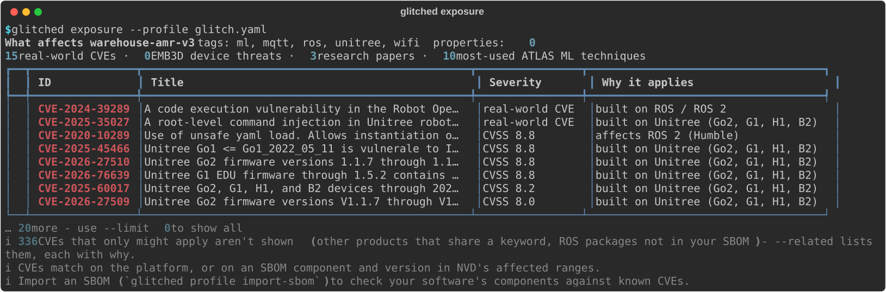

<h3 align="center">
  <a href="https://github.com/glitched-labs/glitched">
    
  </a>
</h3>

<h3 align="center">
  <a href="https://github.com/glitched-labs/glitched/actions/workflows/ci.yml"></a>
  <a href="LICENSE"></a>
  <a href="pyproject.toml"></a>
</h3>

# Security testing for robots

Find the known weaknesses that affect your robot, check them on the robot, and track each one until it's fixed.

**What it does:** Glitched builds a threat database on your machine from MITRE EMB3D (threats to embedded
devices), MITRE ATLAS (attacks on AI systems) and NIST's NVD (CVEs, with CISA's known-exploited list).
Describe your robot - its platforms (ROS 1 and 2, Unitree, Universal Robots, LeRobot), interfaces and
software - and it lists what applies, each with *why*. Then it verifies on a lab robot with passive,
connect-only probes, and keeps every finding from found to fixed. It runs on your machine, against robots you
own or are authorized to test.

**Quickstart:** `uv tool install "git+https://github.com/glitched-labs/glitched" && glitched setup` - see what
affects your robot in about five minutes.

* [Read what Glitched is and who it's for](docs/index.md)
* [Try it without a robot](docs/sample-report.md)

### Use cases
- Know which CVEs and threats apply to a robot before it ships - matched on its platforms, ROS distribution and
  SBOM, not a keyword search on a product name
- Verify on a lab robot: open ports, plaintext protocols, weak TLS, services that answer without a login
- Re-check registered robots on a schedule - `autoscan` exits 1 when something new is confirmed, for cron or CI
- Track findings across scans: fix applied → confirmed resolved, or accepted with a reason and a review date
- Scan a fleet from inside its own network with the dependency-free [on-site runner](docs/runner.md)

### Data sources
MITRE EMB3D, MITRE ATLAS, NIST NVD with CISA's known-exploited list, and your robot's own SBOM (CycloneDX,
SPDX) or package list (`dpkg-query -W`, `pip freeze`, `ros2 pkg list`). Loaded into your own PostgreSQL;
snapshots for machines without internet access.

### A short taste
```bash
glitched onboard           # ~15 plain questions about the robot -> glitch.yaml
glitched exposure          # what applies, ranked, each with why it applies
glitched scan --profile glitch.yaml --host 192.168.50.20 --authorization "self-owned lab device"
```



## Getting started
* [**Install**](docs/install.md): Python 3.11+, PostgreSQL and [uv](https://docs.astral.sh/uv/) - or everything in
  Docker: `docker compose run --rm glitched setup`
* [**The command line**](docs/cli.md): describe a robot, check it, schedule checks, track findings
* [**The robot scan UI**](docs/ui.md): `glitched ui` - the same in your browser, on `127.0.0.1` only
* [**First run**](TESTING.md): a guided 15 minutes, start to finish

### Documentation
- 📚 [Docs](docs/index.md) - also a website: `python -m glitched.docsite serve`
- 🧭 [CLI guide](docs/cli.md) and ⌨️ [command reference](docs/cli-reference.md)
- 🛡️ [Safety: what a scan sends, and the guardrails](docs/safety.md)
- 🗄️ [The threat-intel data system](docs/threat-intel.md)
- 📡 [The on-site runner](docs/runner.md)
- 🧪 [Try it without a robot](docs/sample-report.md)

## Status
Glitched is in early, active development (0.x): commands and file formats may still change between minor
versions. Some things to know:
* **Checks are passive by design.** Anything that needs crafted input or changes the robot is listed for you to do
  and record with `glitched approve` - Glitched never does it on its own.
* **Platform matching** covers ROS 1 and 2, Unitree, Universal Robots and LeRobot so far. Other robots rely on
  their SBOM.
* **NVD loads** take about a minute without a free [NVD API key](https://nvd.nist.gov/developers/request-an-api-key).

Report bugs and ideas as [issues](https://github.com/glitched-labs/glitched/issues), and security problems
privately, as [SECURITY.md](SECURITY.md) describes.

## What is Glitched for?
A robot is a set of computers that can move: an operating system, middleware like ROS, vendor SDKs, network
services, debug ports, a cloud link and, more and more, machine-learning models. The weaknesses that matter
are spread across databases that don't talk to each other, written for IT products rather than machines, and
matched by keyword - so a search for "ROS" returns hundreds of CVEs, most of which don't apply.

Glitched joins those sources and matches them to *your* robot: the platforms it's built on, the ROS
distribution it runs, the exact package versions in its SBOM, and the device properties it has. Every result
says why it applies. Then it checks the robot itself, carefully, and remembers what it found.

### Example use case
Say you're building a warehouse robot on ROS 2 Humble, with a Unitree base, Wi-Fi and an MQTT link to a fleet
server.

`glitched onboard` asks about fifteen plain questions and writes `glitch.yaml`. `glitched exposure` lists the
CVEs for ROS 2 Humble and for Unitree's firmware - not the hundreds that only mention ROS in passing - plus the
EMB3D threats that come with what you said about the robot (a reachable debug port, say), and MITRE ATLAS
techniques because it runs models. You import the robot's package list, and any package in an affected version
range shows up too.

On a lab unit, `glitched scan` finds rosbridge answering on port 9090 without a login, and MQTT in plain text
on 1883. You register the robot with `glitched device add`, put `glitched autoscan` in cron, bind rosbridge to
localhost, turn on TLS for MQTT, and mark both `fix_applied`. The next scan confirms the fixes and resolves
both findings - and if a later firmware update brings one back, `autoscan` exits 1 and you hear about it.

### Glitched vs. a general vulnerability scanner
Network scanners (Nmap, OpenVAS) and dependency scanners (Trivy, Grype) are very good at what they do, and
Glitched works alongside them - it imports the SBOMs they produce. What it adds is robots:

* **Threats for devices, not only CVEs** - MITRE EMB3D for embedded hardware and firmware, and MITRE ATLAS for
  robots that run models.
* **Robot-aware matching** - by platform and ROS distribution, with each result's reason shown.
* **A safety model for machines that move** - one host at a time, private addresses unless approved, an
  authorized-use notice, and nothing intrusive automated.
* **Findings per robot, over time** - found, fix applied, resolved, or accepted with a reason that comes back
  for review.

## Business model
Glitched is open core. The command line, threat-intel pipelines, local scan UI and on-site runner are open
source, under the Apache License 2.0. The **Glitched console** - a hosted app for teams and fleets, with
inventory, risk levels, code scanning with dependency fixes as pull requests, and an API for CI - is a commercial
product built on this package.

# Development
* [`CONTRIBUTING.md`](CONTRIBUTING.md) - set up, the safety bar, regenerating the docs
* [`SECURITY.md`](SECURITY.md) - reporting vulnerabilities privately
* [`RELEASING.md`](RELEASING.md) and [`CHANGELOG.md`](CHANGELOG.md)
* [`docs/threat-intel.md`](docs/threat-intel.md) - the pipelines, dbt models and their tests

Licensed under the [Apache License 2.0](LICENSE). Threat data is downloaded from its sources under their own
terms - see [NOTICE.md](NOTICE.md).
